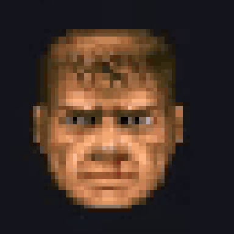
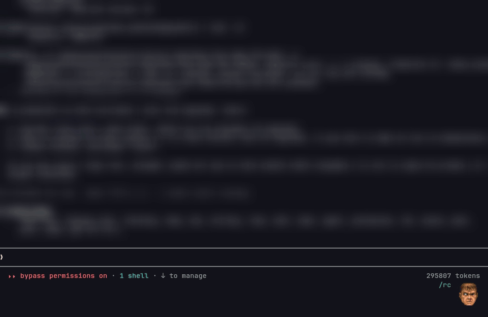

# doom-face

<p align="center"></p>

Your AI pair programmer deserves a face. We gave it the most stressed face in gaming history.

**doom-face** puts the Doomguy from DOOM's status bar in the corner of Claude Code, where he watches your session and feels about it the way you do.

- He rages when Bash runs.
- He takes a hit when a tool fails.
- He grins like a demon when the turn is done.
- He dies when you press Esc. That one's on you.
- He bleeds as the context window fills up. Health is literally `100 - context%`. Compact the conversation and he gets God Mode, as tradition demands.
- He thinks harder when the model thinks harder. At max effort his eyes start glowing gold. Nobody asked for this.

<p align="center"></p>

## Install

```
/plugin install doom-face --marketplace whitetec/doom-face
```

Say `y`, pick the user scope, rip and tear.

**You need:** Claude Code v2.1.287+ and a terminal that can draw pictures, which means **kitty** or **Ghostty**. Anywhere else he stays hidden, which is honestly a relief for him.

**Costs zero tokens.** He never talks to the model and adds nothing to your context. He just watches. Judgingly. (The `/doom` preview command leaves one line in the chat, like `/cost` does. That's it.)

## Settings

In `/config`:

- **Motion**: `full` (the whole show), `calm` (he took his meds) or `still` (one face per mood, like a passport photo).
- **Size**: `small`, `medium` or `large`. Bigger Doomguy, bigger feelings.

## Show me everything

```
/doom demo
```

Or one at a time: `/doom bash`, `/doom pain`, `/doom max`, `/doom dead`... `/doom` alone lists them all. `/doom health` shows how he looks at every level of context, from fresh to "please start a new session".

## How

It's a Claude Code mod: a few hooks in `hooks/register.tsx` that follow your turns, tool calls and the model's effort, and draw him in the footer with the kitty graphics protocol. The faces are read at startup straight from `assets/doom1.wad`, the original 1993 shareware, unmodified. The id Software developers drew him. We only gave him a job.

## License

Code: MIT. The WAD belongs to id Software: see [NOTICE](NOTICE). No demons were harmed. Plenty were coded.
